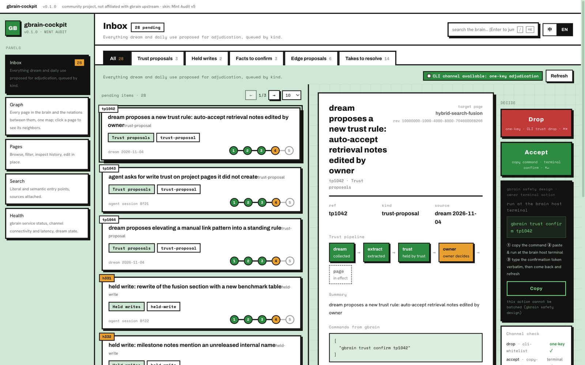
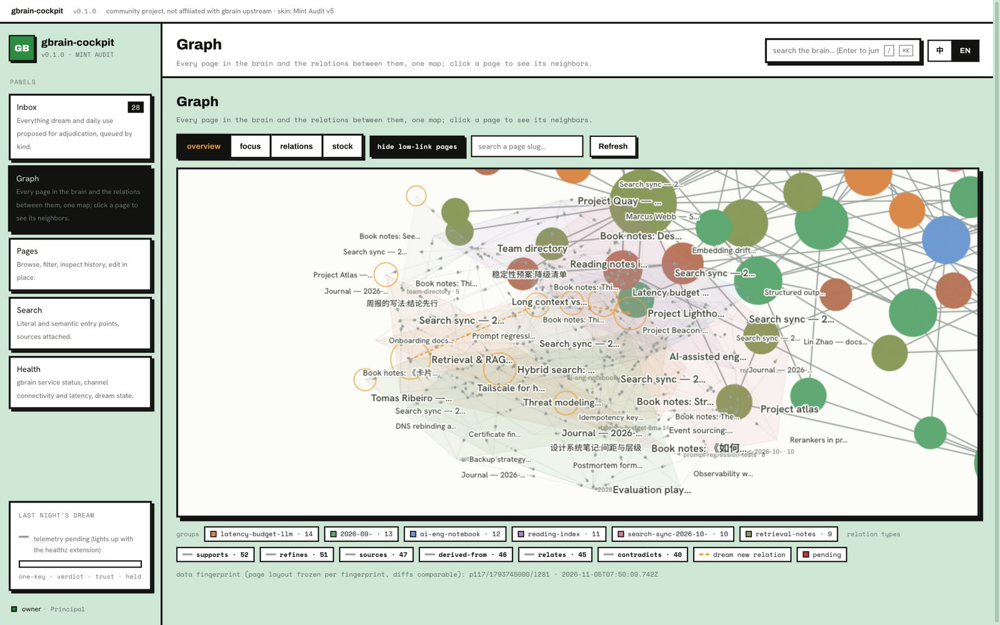
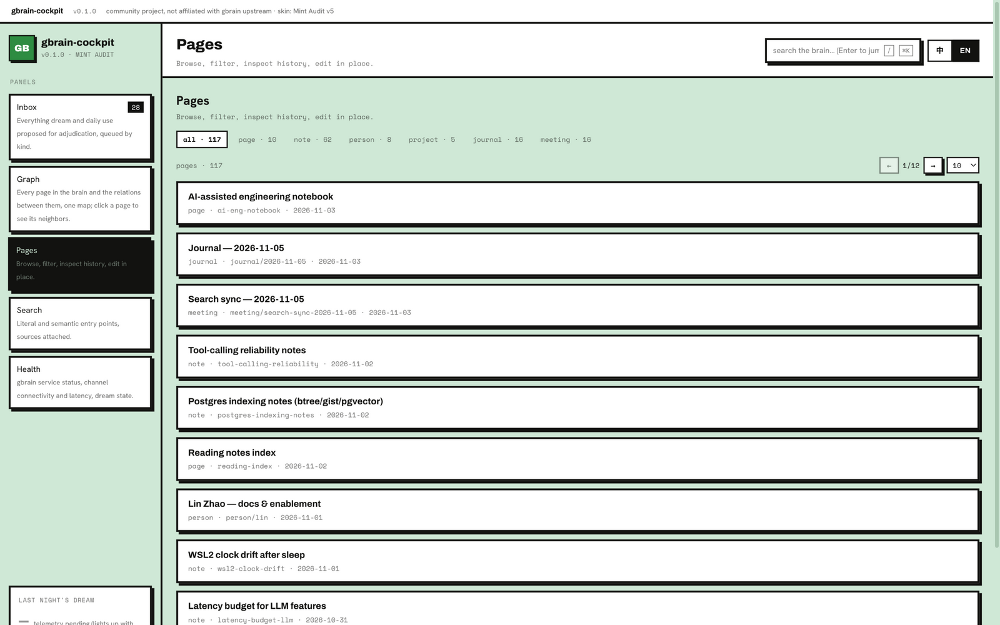
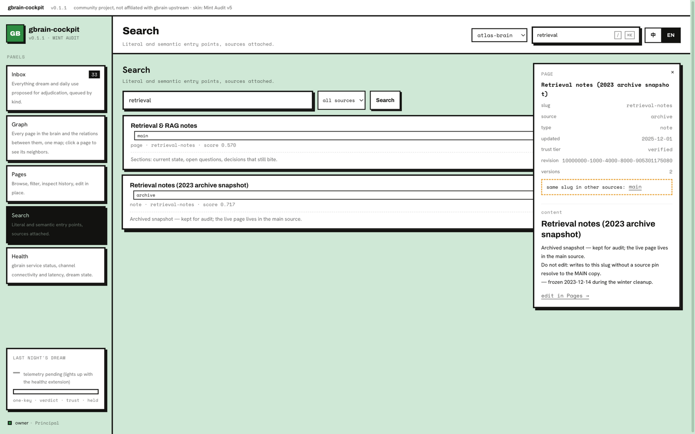
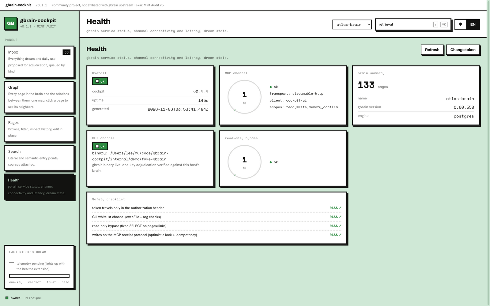

<div align="center">

# gbrain-cockpit

**The missing adjudication & graph UI for self-hosted [gbrain](https://github.com/garrytan/gbrain)**

**English** · [简体中文](README.zh-CN.md)

[](LICENSE)
[](docs/features.md)
[](https://github.com/GeforceLee/gbrain-cockpit/actions/workflows/ci.yml)
[](https://github.com/GeforceLee/gbrain-cockpit/stargazers)
[](https://github.com/GeforceLee/gbrain-cockpit/releases)

</div>

gbrain-cockpit is a web UI for self-hosted gbrain (`gbrain serve`): an **adjudication inbox** that clears out everything the nightly `dream` maintenance cycle produces, a **whole-brain graph** for roaming your entire knowledge base, plus page browsing, search, and a service health panel.

```
dream proposes overnight → you adjudicate in the inbox each morning → the graph is always roamable
```

## Why

The official and community interfaces each cover a slice of the problem — nobody covers content adjudication:

| | Official `/admin` | gbrain.io | Community Stargraph | **gbrain-cockpit** |
|---|---|---|---|---|
| Ops monitoring (requests / jobs / credentials) | ✅ | ✅ | — | Linked out, no duplication |
| Memory content browsing / editing | — | ✅ (hosted brains only) | Partial | ✅ |
| Knowledge graph visualization | — | — | ✅ | ✅ |
| **dream output adjudication** (takes / trust / edges / facts) | — | — | — | ✅ **the core gap** |

## Panels

- **Inbox** — the adjudication desk: trust proposals, held writes, facts to confirm, edge proposals, LLM-proposed takes; one-key stamps where gbrain allows it, copy-command blocks where gbrain deliberately requires your terminal
- **Graph** — every page and relation on one canvas map, community-colored, with relation-type filters and a node drawer
- **Pages** — type facets, deep pagination, in-place editing on gbrain's write-receipt protocol
- **Search** — the cheap hybrid (literal + semantic) entry point
- **Health** — channel status, latency, and the safety checklist

See the [feature guide](docs/features.md) and the [architecture overview](docs/architecture.md) for the full picture.

## Screenshots

<p align="center">
  
  
</p>
<p align="center">
  
  
</p>
<p align="center">
  
</p>

*Screenshots run on synthetic demo data (a 117-page brain with power-law link distribution) — desensitized by construction; the UI itself is what ships.*

## Quick start

Prerequisites: [Bun](https://bun.sh) ≥ 1.2 and a running `gbrain serve` (MCP endpoint reachable). One-key adjudication additionally wants cockpit **on the brain host** with the `gbrain` CLI on PATH — elsewhere those actions degrade to copy-command blocks automatically.

```bash
# 1. On the brain host: mint a token for cockpit.
#    Takes holders default to `world` (fail-closed) — list every holder,
#    or the takes queues will look empty in the UI.
gbrain auth create cockpit-ui --scopes read,write,memory_confirm --takes-holders <all-holders>

# 2. On the cockpit host:
git clone https://github.com/GeforceLee/gbrain-cockpit.git
cd gbrain-cockpit
cp .env.example .env    # fill COCKPIT_TOKEN, GBRAIN_MCP_TOKEN, GBRAIN_TAKES_HOLDERS
bun install
bun run dev             # server :8787 + web dev server :5173 (proxies /api)
```

Open <http://127.0.0.1:5173>, paste `COCKPIT_TOKEN` at the gate, done.

For the whole-brain graph, additionally create the read-only Postgres role (snippets in [`.env.example`](.env.example)) and set `PG_READONLY_DSN`. On the brain host, also consider enabling gbrain's cli-socket (`gbrain config set serve.cli_socket true`, then restart serve) so CLI actions run at near-MCP speed.

### Production form

```bash
bun run build                       # web → web/dist
cd server && bun start              # serves the built UI at :8787
```

For a long-running host use the systemd unit template at [`server/deploy/cockpit.service`](server/deploy/cockpit.service) (source-form, `EnvironmentFile` outside the release tree), or grab a compiled binary from [Releases](https://github.com/GeforceLee/gbrain-cockpit/releases) (`cockpit-darwin-arm64` / `cockpit-linux-x64`, static root via `COCKPIT_DIST_DIR`). Remote access should go through a reverse proxy or an encrypted tunnel on `127.0.0.1` — "LAN" is not a trust boundary.

## Configuration

Ten environment variables, all annotated in [`.env.example`](.env.example); the full table lives in the [architecture overview](docs/architecture.md#configuration). Two are required (fail-closed): `COCKPIT_TOKEN` and `GBRAIN_MCP_TOKEN`.

## Safety design

cockpit is deliberately conservative with your brain:

- **Never bypasses gbrain's owner-presence design** — accepting trust proposals / releasing held writes stays "copy the command, run it at the brain host terminal"
- **Never writes to the gbrain database** — page writes ride MCP with optimistic locking, idempotent ids, and receipt polling; the only SQL is a fixed read-only SELECT for the graph
- **Treats brain content as untrusted input** — markdown rendering goes through the single marked → DOMPurify pipeline (scripts/images/forms stripped, links hardened); no other `innerHTML` anywhere, graph labels on canvas

The channel each action travels is a compile-time constant — no runtime rerouting. Details: [architecture overview](docs/architecture.md).

## Status

Early access (0.x): the five panels and all three channels are working software, verified against gbrain 0.60.x; rough edges and schema drift across gbrain releases are expected and degrade visibly rather than crash. Next up: rich page rendering, the graph's MCP fallback path, `/metrics`, and a Docker channel — see the roadmap in the [architecture overview](docs/architecture.md#roadmap-not-in-01).

The UI ships bilingually (English / 简体中文) with every panel, action and empty state carrying a one-line self-description.

## Not affiliated

gbrain-cockpit is a community project with no affiliation to gbrain (garrytan/gbrain). gbrain is Garry Tan's open-source project (MIT); this project only consumes it read-only and invokes its official commands — it never modifies gbrain's data conventions.

## Star History

[](https://star-history.com/#GeforceLee/gbrain-cockpit&Date)

## License

[MIT](LICENSE)
