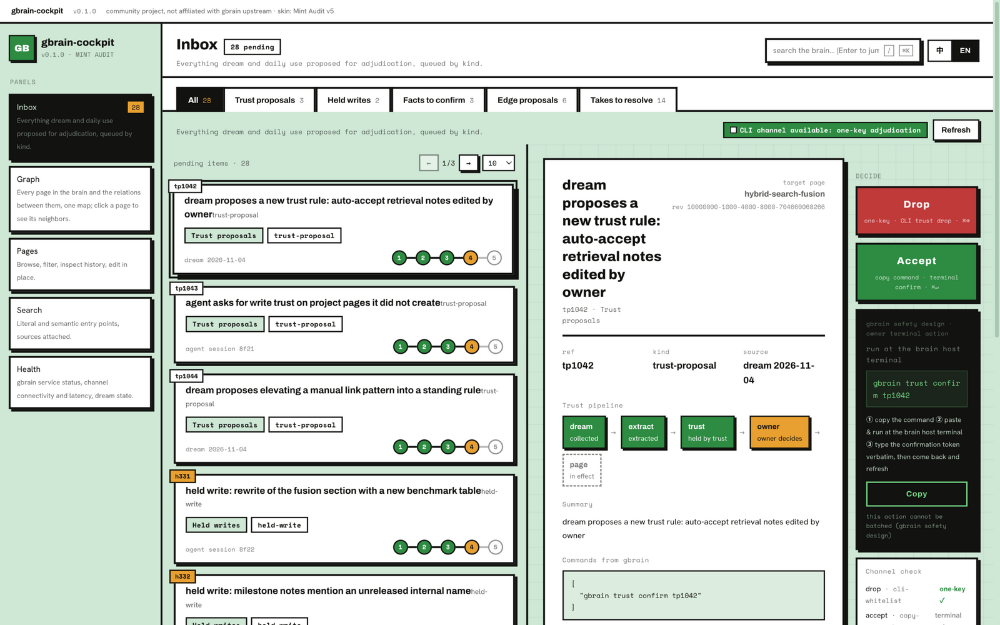
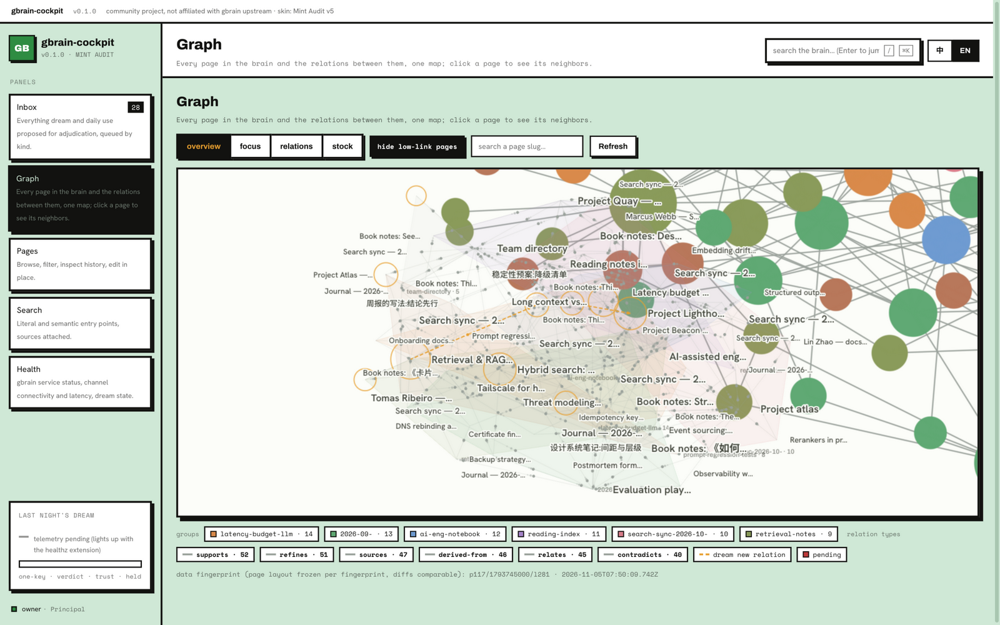
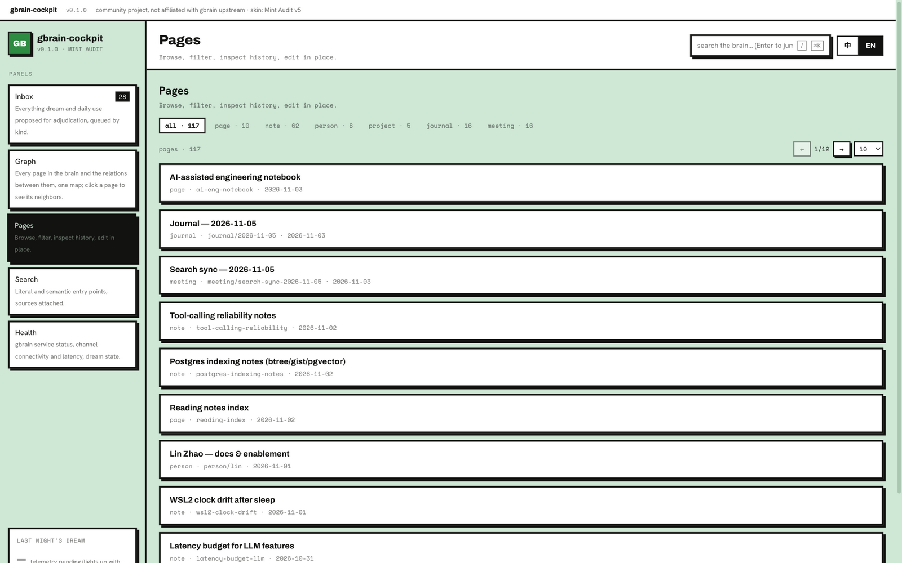
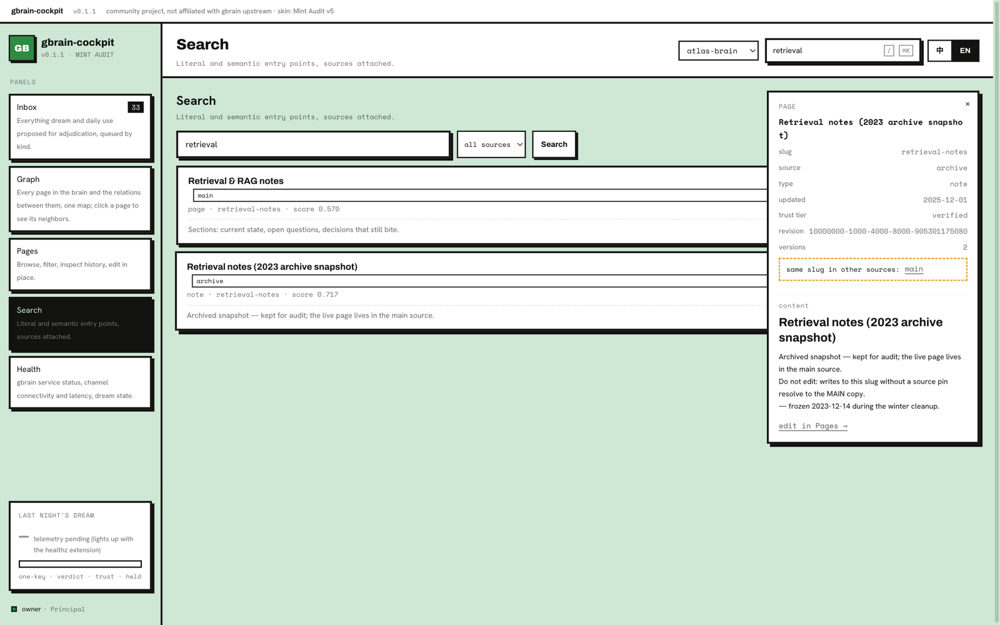
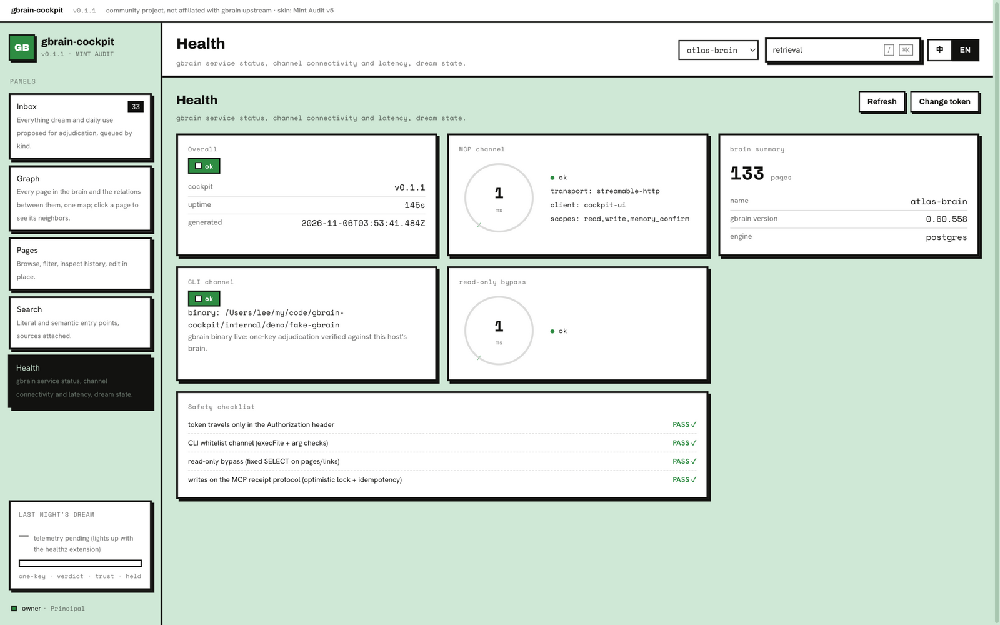

<div align="center">

# gbrain-cockpit

**The missing adjudication & graph UI for self-hosted [gbrain](https://github.com/garrytan/gbrain)**

**English** · [简体中文](README.zh-CN.md)

[](LICENSE)
[](docs/features.md)
[](https://github.com/GeforceLee/gbrain-cockpit/actions/workflows/ci.yml)
[](https://github.com/GeforceLee/gbrain-cockpit/stargazers)
[](https://github.com/GeforceLee/gbrain-cockpit/releases)

</div>

gbrain-cockpit is a web UI for self-hosted gbrain (`gbrain serve`): an **adjudication inbox** that clears out everything the nightly `dream` maintenance cycle produces, a **whole-brain graph** for roaming your entire knowledge base, plus page browsing, search, and a service health panel.

```
dream proposes overnight → you adjudicate in the inbox each morning → the graph is always roamable
```

## Why

The official and community interfaces each cover a slice of the problem — nobody covers content adjudication:

| | Official `/admin` | gbrain.io | Community Stargraph | **gbrain-cockpit** |
|---|---|---|---|---|
| Ops monitoring (requests / jobs / credentials) | ✅ | ✅ | — | Linked out, no duplication |
| Memory content browsing / editing | — | ✅ (hosted brains only) | Partial | ✅ |
| Knowledge graph visualization | — | — | ✅ | ✅ |
| **dream output adjudication** (takes / trust / edges / facts) | — | — | — | ✅ **the core gap** |

## Panels

- **Inbox** — the adjudication desk: trust proposals, held writes, facts to confirm, edge proposals, LLM-proposed takes; one-key stamps where gbrain allows it, copy-command blocks where gbrain deliberately requires your terminal
- **Graph** — every page and relation on one canvas map, community-colored, with relation-type filters and a node drawer
- **Pages** — type facets, deep pagination, in-place editing on gbrain's write-receipt protocol
- **Search** — the cheap hybrid (literal + semantic) entry point
- **Ask** — ask in plain words: free evidence in ~2 s, and a cited brief from the model behind one priced click
- **Health** — channel status, latency, and the safety checklist

See the [feature guide](docs/features.md) and the [architecture overview](docs/architecture.md) for the full picture.

## Screenshots

<p align="center">
  
  
</p>
<p align="center">
  
  
</p>
<p align="center">
  
</p>

*Screenshots run on synthetic demo data (a 133-page two-source brain — 117 live pages + a 16-page federated archive, including one same-slug pair — with power-law link distribution) — desensitized by construction; the UI itself is what ships.*

## Quick start

Prerequisites: [Bun](https://bun.sh) ≥ 1.2 and a running `gbrain serve` (MCP endpoint reachable). One-key adjudication additionally wants cockpit **on the brain host** with the `gbrain` CLI on PATH — elsewhere those actions degrade to copy-command blocks automatically.

```bash
# 1. On the brain host: mint a token for cockpit.
#    Takes holders default to `world` (fail-closed) — list every holder,
#    or the takes queues will look empty in the UI.
gbrain auth create cockpit-ui --scopes read,write,memory_confirm --takes-holders <all-holders>

# 2. On the cockpit host:
git clone https://github.com/GeforceLee/gbrain-cockpit.git
cd gbrain-cockpit
cp .env.example .env    # fill COCKPIT_TOKEN, GBRAIN_MCP_TOKEN, GBRAIN_TAKES_HOLDERS
bun install
bun run dev             # server :8787 + web dev server :5173 (proxies /api)
```

Open <http://127.0.0.1:5173>, paste `COCKPIT_TOKEN` at the gate, done. Teammates sign in the same way, with an access token you issue them — see [Issue access tokens for your team](#issue-access-tokens-for-your-team).

For the whole-brain graph, additionally create the read-only Postgres role (snippets in [`.env.example`](.env.example)) and set `PG_READONLY_DSN`. On the brain host, also consider enabling gbrain's cli-socket (`gbrain config set serve.cli_socket true`, then restart serve) so CLI actions run at near-MCP speed.

### Production form

```bash
bun run build                       # web → web/dist
cd server && bun start              # serves the built UI at :8787
```

For a long-running host use the systemd unit template at [`server/deploy/cockpit.service`](server/deploy/cockpit.service) (source-form, `EnvironmentFile` outside the release tree), or grab a compiled binary from [Releases](https://github.com/GeforceLee/gbrain-cockpit/releases) (`cockpit-darwin-arm64` / `cockpit-linux-x64`, static root via `COCKPIT_DIST_DIR`). Remote access should go through a reverse proxy or an encrypted tunnel on `127.0.0.1` — "LAN" is not a trust boundary. The unit also caps restarts (5 attempts in 60 seconds), so a configuration error — a broken token registry, a mistyped origin list — stops the service instead of looping forever; fix the file, then `systemctl reset-failed cockpit` and start it again.

**Mounting under a path prefix?** If a proxy strips a prefix before `:8787` (say `/cockpit/` → `127.0.0.1:8787`), build with that prefix so the bundle carries it: `COCKPIT_BASE=/cockpit/ bun run build`. Without it the bundle mounts at `/` — which is what the release binaries and `web-dist.tar.gz` are built for.

### Behind a reverse proxy

Every write request is checked against cross-site forgery with one rule: the `Origin` the browser sends must equal the `Host` the server receives. A proxy changes what the server receives, so which variable you need depends on one question — **what the proxy does to the `Host` header**:

| The proxy… | What cockpit sees | Set |
|---|---|---|
| **passes `Host` through unchanged** | `Host: cockpit.example.com` is not on cockpit's built-in list, so every request — reads too — is rejected with a 400 | `COCKPIT_ALLOWED_HOSTS=cockpit.example.com` |
| **rewrites `Host` to its upstream address** | `Host: 127.0.0.1:8787` is accepted, but the browser's `Origin` (`https://cockpit.example.com`) no longer equals it, so every write is rejected with a 403 | `COCKPIT_ALLOWED_ORIGINS=https://cockpit.example.com` |

- `COCKPIT_ALLOWED_HOSTS` — comma-separated `Host` values. An entry without a port matches both as written and with `COCKPIT_PORT` appended (until 0.7 only the port-appended spelling was accepted, so a public domain could not be registered at all).
- `COCKPIT_ALLOWED_ORIGINS` — comma-separated site addresses. Each entry must be one exact canonical origin — `https`, lowercase host, no path, no trailing slash, no default port (`http://127.0.0.1:<port>` is accepted for a loopback-only setup). A malformed entry refuses to start rather than leave writes silently broken. Unset = the check is exactly what it was.
- Nothing is relaxed. Another site's origin matches neither the `Host` nor the list, so its forged writes are still refused, and cockpit never trusts `X-Forwarded-*` headers. Both lists may be set at once. An encrypted tunnel that ends on `127.0.0.1:8787` needs neither.

## Configuration

All variables are annotated in [`.env.example`](.env.example); the full table lives in the [architecture overview](docs/architecture.md#configuration). Two are required (fail-closed): `COCKPIT_TOKEN` and `GBRAIN_MCP_TOKEN`.

Who may sign in, and how the entry point is reached:

| Variable | Required | Purpose |
|---|---|---|
| `COCKPIT_TOKEN` | **yes** | the admin's sign-in token: view, adjudicate, ops reads and the paid deep answer, on every configured brain |
| `COCKPIT_ADMIN_TOKEN` | no | the admin's second token: additionally opens management writes — source grant widening, the paid model probe, issuing / changing / revoking access tokens. Must differ from `COCKPIT_TOKEN` |
| `COCKPIT_TOKENS_FILE` | no | absolute path of the access-token registry, outside the release tree. Unset = access tokens are off; only the two tokens above sign in |
| `COCKPIT_ALLOWED_HOSTS` | no | extra allowed `Host` values — for a proxy that passes the browser's `Host` through unchanged |
| `COCKPIT_ALLOWED_ORIGINS` | no | extra origins accepted on writes — for a proxy that rewrites `Host` |

Multiple brains: point `COCKPIT_PROFILES_FILE` at a profiles JSON (one entry per gbrain deployment — MCP endpoint + credential, optional read-only DSN, optional CLI command name for wrapper brains like `gbrain-bip`). The top bar grows a switcher; the legacy variables keep working when the file is unset. See [Multi-brain profiles](docs/architecture.md#multi-brain-profiles) and [Source federation](docs/architecture.md#source-federation).

## Issue access tokens for your team

The two env tokens belong to the admin: `COCKPIT_TOKEN` also opens the ops surface and the paid deep answer, so it is a poor thing to share. An **access token** is issued per person, carries a name, and does exactly what its **permission sheet** says — nothing else. It can be changed or revoked at any time, and the audit trail records who did what.

This is step one of two: **view + adjudicate**. Letting teammates edit pages, source by source, is the second step and is **not open yet**.

**The permission sheet.** Every access token can **view** — browse pages, search, the graph, the free evidence leg of Ask. On top of that the sheet says:

- **Brains** — which brain instances it may enter (at least one; the first is its default).
- **Adjudicate** — whether it may handle the Inbox: drop, accept / reject takes and edge proposals, resolve judgments, mute and snooze.
- *Edit sources* — reserved for the second step. The issue form does not offer it and the server rejects it.

Two things the sheet does **not** divide by source, by design: *view* reaches every source the deployment's gbrain credential can read, and *adjudicate* can change a page in any source (accepting a proposal writes into the page it came from).

**What an access token can never call.** The server refuses with a 403 that names what is missing: everything under `/api/ops/*`, the paid deep answer (`POST /api/ask/think`), the health diagnostics, fact confirmation, the write-receipt lists and write cancel, page saves, token management, and the raw audit tail. Inbox data arrives without command text and without the CLI command name; page details without the host file path.

**Three steps to hand out the first token:**

1. **Create the registry file** — as the service account, outside the release tree:

   ```bash
   printf '{"version":1,"tokens":[]}\n' > /home/you/cockpit/tokens.json
   chmod 600 /home/you/cockpit/tokens.json
   ```

   It must already exist, be owned by the service account, and not be writable by anyone else — and its directory must not be open to everyone for writing. Anything else, a missing or malformed file included, refuses the start: cockpit never treats a registry it cannot read as empty. Only SHA-256 digests are ever written to it, and one server at a time may use a registry file.

2. **Point cockpit at it and restart** — `COCKPIT_TOKENS_FILE=/home/you/cockpit/tokens.json` in the environment file. Issuing is a management write, so `COCKPIT_ADMIN_TOKEN` must be set as well.

3. **Issue in the web UI** — sign in with an env token, open **Admin → Access tokens** (the top card), press **Issue a token**, fill in the name, the brains and whether they may adjudicate, and paste the admin token once — it is used for that one action only. The plaintext token is shown **once**: copy it and hand it over privately, in person or through a password manager. If it never reaches the person, revoke it and issue a new one.

**Change permissions** replaces the whole sheet; **Revoke** takes effect on the next request and cannot be undone. Both ask for the admin token once, and neither needs a restart. If `COCKPIT_TOKEN` was shared with teammates in the past, rotate it once everyone has a token of their own — the env tokens are not limited by any sheet.

See [Access tokens](docs/features.md#access-tokens) for what each kind of token sees, and [Authentication and authorization](docs/architecture.md#authentication-and-authorization) for how it is enforced.

## Safety design

cockpit is deliberately conservative with your brain:

- **Never bypasses gbrain's owner-presence design** — accepting trust proposals / releasing held writes stays "copy the command, run it at the brain host terminal"
- **Never writes to the gbrain database** — page writes ride MCP with optimistic locking, idempotent ids, and receipt polling; the only SQL is a fixed read-only SELECT for the graph
- **Treats brain content as untrusted input** — markdown rendering goes through the single marked → DOMPurify pipeline (scripts/images/forms stripped, links hardened); no other `innerHTML` anywhere, graph labels on canvas
- **Every `/api` route is classified, and one gate enforces it** — each route declares its class (view / adjudicate / edit / reserved for the admin's env tokens) in a single route table; a route without a class does not build. An access token is refused by default: it gets view, plus only what its permission sheet grants
- **Access tokens are stored as digests** — the registry holds SHA-256 digests only; the plaintext exists in exactly one response, at issue time. Revoking is immediate and final

The channel each action travels is a compile-time constant — no runtime rerouting. Details: [architecture overview](docs/architecture.md).

## Status

Early access (0.x): seven panels (plus an Admin tab, shown to the admin's env tokens when the deployment configures the admin token) and all three channels are working software, verified against gbrain 0.60.x; rough edges and schema drift across gbrain releases are expected and degrade visibly rather than crash. Next up: the graph's MCP fallback path, `/metrics`, and a Docker channel — see the roadmap in the [architecture overview](docs/architecture.md#roadmap-not-in-01). Changes release by release: [CHANGELOG](CHANGELOG.md).

The UI ships bilingually (English / 简体中文) with every panel, action and empty state carrying a one-line self-description.

## Not affiliated

gbrain-cockpit is a community project with no affiliation to gbrain (garrytan/gbrain). gbrain is Garry Tan's open-source project (MIT); this project only consumes it read-only and invokes its official commands — it never modifies gbrain's data conventions.

## Star History

[](https://star-history.com/#GeforceLee/gbrain-cockpit&Date)

## License

[MIT](LICENSE)
