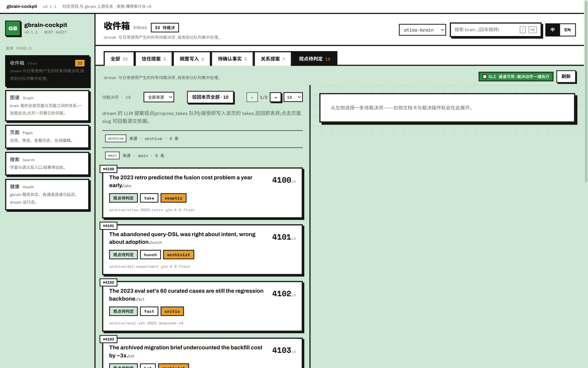
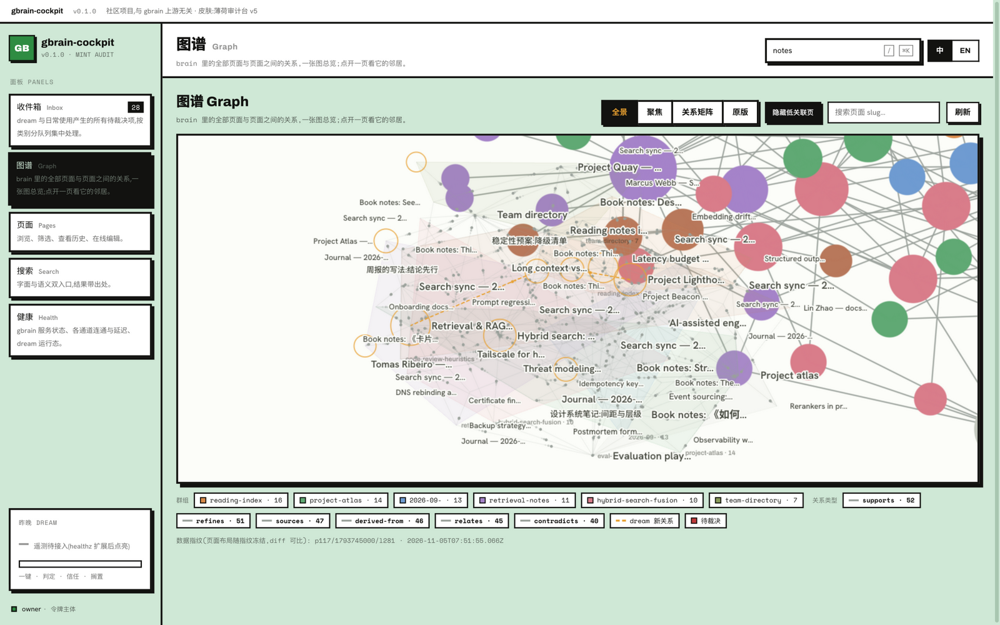
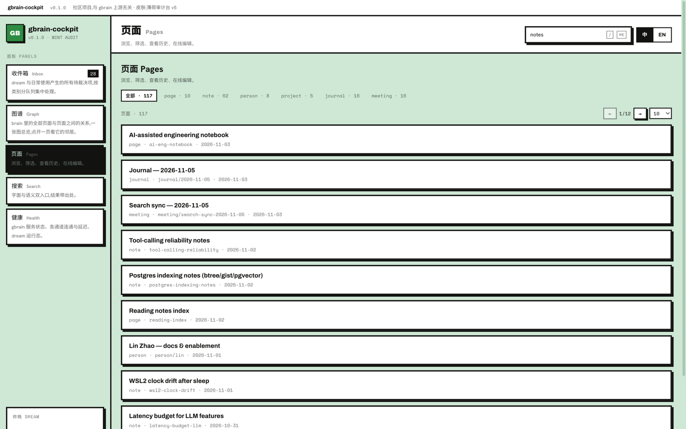
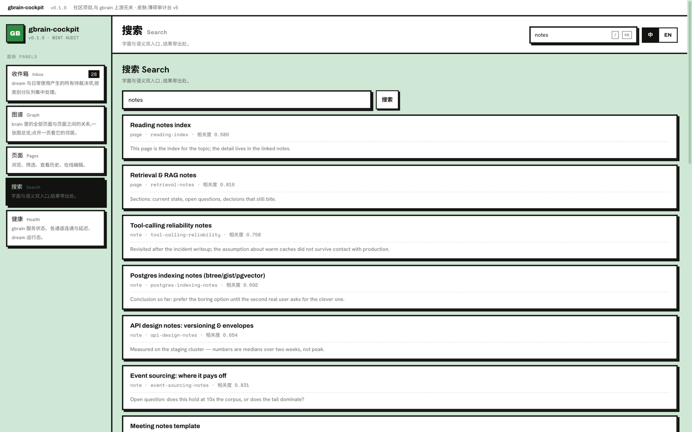
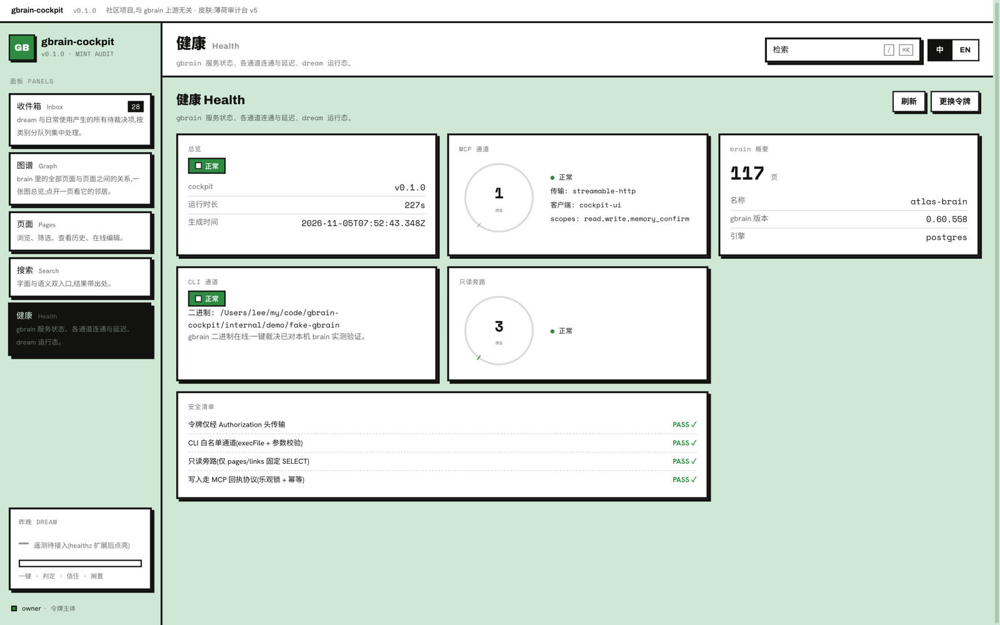

<div align="center">

# gbrain-cockpit

**自托管 [gbrain](https://github.com/garrytan/gbrain) 缺失的裁决收件箱与图谱界面**

[English](README.md) · **简体中文**

[](LICENSE)
[](docs/features.zh-CN.md)
[](https://github.com/GeforceLee/gbrain-cockpit/actions/workflows/ci.yml)
[](https://github.com/GeforceLee/gbrain-cockpit/stargazers)
[](https://github.com/GeforceLee/gbrain-cockpit/releases)

</div>

gbrain-cockpit 是面向自托管 gbrain(`gbrain serve`)的 Web 界面:一个清空 nightly `dream` 维护周期全部产出的**裁决收件箱**,一张漫游整个知识库的**全脑图谱**,外加页面浏览、搜索与服务健康面板。

```
dream 整夜提案 → 你早晨在收件箱一键裁决 → 图谱始终保持可漫游
```

## 为什么做

官方与社区界面各覆盖一角——没人覆盖内容裁决:

| | 官方 `/admin` | gbrain.io | 社区 Stargraph | **gbrain-cockpit** |
|---|---|---|---|---|
| 运维监控(请求 / 任务 / 凭据) | ✅ | ✅ | — | 外链不重复 |
| 记忆内容浏览 / 编辑 | — | ✅(仅托管 brain) | 部分 | ✅ |
| 知识图谱可视化 | — | — | ✅ | ✅ |
| **dream 产出的裁决**(takes / trust / 关系 / 事实) | — | — | — | ✅ **核心空白** |

## 面板

- **收件箱** —— 裁决台:信任提案、搁置写入、待确认事实、关系提案、LLM 提案观点;gbrain 允许的一键盖章,gbrain 刻意要求终端的渲染为复制命令块
- **图谱** —— 全部页面与关系一张 canvas 地图,社区配色,关系类型筛选,节点抽屉
- **页面** —— 类型筛选、深度分页、走 gbrain 写回执协议的在线编辑
- **搜索** —— 便宜的字面 + 语义混合入口
- **问一句** —— 用白话提问:约 2 秒给出免费证据;要带出处的简报,点一下标了价格的按钮,由模型读过相关页面后作答
- **健康** —— 通道状态、延迟与安全清单

完整说明见[功能指南](docs/features.zh-CN.md)与[架构概览](docs/architecture.zh-CN.md)。

## 界面截图

<p align="center">
  
  
</p>
<p align="center">
  
  
</p>
<p align="center">
  
</p>

*截图基于合成演示数据(133 页双源 brain——117 页主源 + 16 页联邦归档源,含一对跨源同名页——幂律连接分布)——数据由构造即脱敏,界面即所发版本。*

## 快速开始

前置:[Bun](https://bun.sh) ≥ 1.2,一个运行中的 `gbrain serve`(MCP 端点可达)。一键裁决还需要 cockpit **与 brain 同机**且 `gbrain` CLI 在 PATH 上——否则这些动作自动降级为复制命令块。

```bash
# 1. 在 brain 主机上为 cockpit 铸造 token。
#    takes 的可见域默认 fail-closed 收窄到 `world`——必须列出全部 holder,
#    否则界面上的观点队列会是空的。
gbrain auth create cockpit-ui --scopes read,write,memory_confirm --takes-holders <全部-holder>

# 2. 在 cockpit 主机上:
git clone https://github.com/GeforceLee/gbrain-cockpit.git
cd gbrain-cockpit
cp .env.example .env    # 填 COCKPIT_TOKEN、GBRAIN_MCP_TOKEN、GBRAIN_TAKES_HOLDERS
bun install
bun run dev             # server :8787 + 前端 dev server :5173(代理 /api)
```

打开 <http://127.0.0.1:5173>,在登录页粘贴 `COCKPIT_TOKEN` 即可。同事用你签发的访问令牌走同一个入口登录——见[给团队发钥匙](#给团队发钥匙)。

要启用全脑图谱,另需创建只读 Postgres 账号(命令片段见 [`.env.example`](.env.example))并设置 `PG_READONLY_DSN`。在 brain 主机上,建议顺手开启 gbrain 的 cli-socket(`gbrain config set serve.cli_socket true` 后重启 serve),CLI 动作即以接近 MCP 的速度执行。

### 生产形态

```bash
bun run build                       # 前端 → web/dist
cd server && bun start              # 在 :8787 提供构建后的界面
```

长期运行的主机可用 systemd 单元模板 [`server/deploy/cockpit.service`](server/deploy/cockpit.service)(源码形态,`EnvironmentFile` 放在发布目录之外),或从 [Releases](https://github.com/GeforceLee/gbrain-cockpit/releases) 下载编译二进制(`cockpit-darwin-arm64` / `cockpit-linux-x64`,静态根目录用 `COCKPIT_DIST_DIR` 指定)。远程访问请经反代或加密隧道落在 `127.0.0.1` 上——「内网」不是信任边界。单元文件还限制了重启次数(60 秒内 5 次):配置出错时——登记表文件坏了、站点地址名单写错——服务会停下,而不是无限重启;修好文件后执行 `systemctl reset-failed cockpit` 再启动。

**要挂在路径前缀下面?** 如果代理会先剥掉前缀再转给 `:8787`(比如 `/cockpit/` → `127.0.0.1:8787`),构建时把前缀带上:`COCKPIT_BASE=/cockpit/ bun run build`。不带时界面挂在根路径 `/`——发布页的二进制和 `web-dist.tar.gz` 都是按这个构建的。

### 放在反向代理后面

每个写请求都要过一道防跨站伪造的检查,规则只有一条:浏览器带来的 `Origin` 必须等于服务端收到的 `Host`。代理会改变服务端收到的东西,所以要用哪个变量,只取决于一个问题——**代理怎么处理 `Host` 请求头**:

| 代理的做法 | cockpit 看到的 | 要设的变量 |
|---|---|---|
| **原样透传 `Host`** | `Host: cockpit.example.com` 不在 cockpit 的内置名单里,所有请求(读也算)都被拒,回 400 | `COCKPIT_ALLOWED_HOSTS=cockpit.example.com` |
| **把 `Host` 改写成它转发的地址** | `Host: 127.0.0.1:8787` 能通过,但浏览器的 `Origin`(`https://cockpit.example.com`)和它不相等,所有写请求被拒,回 403 | `COCKPIT_ALLOWED_ORIGINS=https://cockpit.example.com` |

- `COCKPIT_ALLOWED_HOSTS`——逗号分隔的 `Host` 值。不带端口的条目,原样和补上 `COCKPIT_PORT` 两种写法都认(0.7 之前只认补端口的写法,外部域名根本登记不进去)。
- `COCKPIT_ALLOWED_ORIGINS`——逗号分隔的站点地址。每一项必须是一个规范的完整站点地址:`https`、主机小写、不带路径、不带尾斜杠、不带默认端口(只有本机访问的部署可以用 `http://127.0.0.1:<端口>`)。写错一项就拒绝启动,不会让写请求悄悄一直失败。不设 = 检查和以前完全一样。
- 检查本身没有放松。别的网站的站点地址既不等于 `Host`、也不在名单里,伪造的写请求照样被拒;cockpit 从不信任 `X-Forwarded-*` 请求头。两份名单可以同时设。终点落在 `127.0.0.1:8787` 的加密隧道两个都不需要。

## 配置

全部变量都带注释,见 [`.env.example`](.env.example);完整表格在[架构概览](docs/architecture.zh-CN.md#配置)。其中两个必填(fail-closed):`COCKPIT_TOKEN` 与 `GBRAIN_MCP_TOKEN`。

谁能登录,以及入口怎么进来:

| 变量 | 必填 | 用途 |
|---|---|---|
| `COCKPIT_TOKEN` | **是** | 管理员的登录令牌:能看、能裁决、能读运维信息、能用付费深度问答,对所有已配置的脑实例都有效 |
| `COCKPIT_ADMIN_TOKEN` | 否 | 管理员的第二把令牌:再加上管理类写操作——来源补授权、付费模型探测、签发 / 改权限 / 作废访问令牌。必须与 `COCKPIT_TOKEN` 不同 |
| `COCKPIT_TOKENS_FILE` | 否 | 访问令牌登记表文件的绝对路径,放在发布目录之外。不设 = 访问令牌功能关闭,只有上面两把令牌能登录 |
| `COCKPIT_ALLOWED_HOSTS` | 否 | 额外允许的 `Host` 值——代理原样透传浏览器的 `Host` 时用 |
| `COCKPIT_ALLOWED_ORIGINS` | 否 | 写请求额外放行的站点地址——代理改写 `Host` 时用 |

多脑:把 `COCKPIT_PROFILES_FILE` 指向一个 profiles JSON(每个 gbrain 部署一条——MCP 端点+凭证、可选只读 DSN、可选 CLI 命令名以支持 `gbrain-bip` 这类包装脑)。顶栏会出现切换器;不设该文件时旧变量继续工作。详见[多 brain(多实例)](docs/architecture.zh-CN.md#多-brain多实例)与[多 source 联邦](docs/architecture.zh-CN.md#多-source-联邦)。

## 给团队发钥匙

两个环境变量令牌属于管理员:`COCKPIT_TOKEN` 同时能调运维接口、能用付费深度问答,不适合发给别人。**访问令牌**按人签发、带着名字,只做它那张**权限单**上写的事,多一件都不行。随时能改、能作废,审计里记着是谁做的。

这是两步里的第一步:**看 + 裁决**。让同事按来源编辑页面是第二步,**尚未开放**。

**权限单。** 每把访问令牌都能**看**(view)——浏览页面、搜索、图谱、问一句里免费的找证据。在这之上,权限单写明:

- **能进哪些脑实例**——至少一个;排第一的是他的默认脑实例。
- **能不能裁决**(adjudicate)——能不能处理收件箱:驳回、接受 / 驳回观点提案和关系提案、判定、静音和稍后再看。
- *能改哪些来源*——留给第二步。签发表单里没有这一项,服务端也不接受。

有两件事权限单**不**按来源划分,这是有意为之:*看* 能读到这个部署的 gbrain 凭证能读到的全部来源;*裁决* 能改动任何来源的页面(接受一条提案,就是把它写进它所在的那一页)。

**访问令牌调不了的接口。** 服务端一律拒绝,回 403 并写明缺的是哪一项:`/api/ops/*` 下的全部、付费深度问答(`POST /api/ask/think`)、健康诊断、确认入库、写收据列表和作废写入、保存页面、令牌管理、审计原文。访问令牌拿到的收件箱数据不带命令文本、不带命令行的名字;页面详情不带主机上的文件路径。

**发出第一把令牌,三步:**

1. **建登记表文件**——以服务账号的身份,放在发布目录之外:

   ```bash
   printf '{"version":1,"tokens":[]}\n' > /home/you/cockpit/tokens.json
   chmod 600 /home/you/cockpit/tokens.json
   ```

   文件必须已经存在、属主是服务账号、别人不可写,所在目录也不能对所有人开放写权限。不满足任何一条——文件不存在或内容不对也算——都拒绝启动:cockpit 绝不会把读不懂的登记表当成空的。文件里只会写入 SHA-256 摘要;一个登记表文件同一时间只允许一个服务在用。

2. **让 cockpit 指向它,然后重启**——在环境变量文件里设 `COCKPIT_TOKENS_FILE=/home/you/cockpit/tokens.json`。签发属于管理类写操作,所以 `COCKPIT_ADMIN_TOKEN` 也要设好。

3. **在网页里签发**——用环境变量令牌登录,打开**管理 → 访问令牌**(最上面那张卡片),点**签发新令牌**,填名字、勾脑实例、勾要不要裁决,然后粘贴一次管理令牌——它只用于这一次操作。明文令牌**只显示这一次**:请复制下来,当面或通过密码管理器交给本人。万一没送到,就作废它、重新签一把。

**改权限**会整张替换权限单;**作废**下一个请求就生效,不能恢复。两者都只要求粘贴一次管理令牌,都不用重启。如果以前把 `COCKPIT_TOKEN` 发给过同事,等大家都有了各自的令牌,就把它换掉——环境变量令牌不受任何权限单约束。

每种令牌能看到什么,见[访问令牌](docs/features.zh-CN.md#访问令牌);是怎么在服务端拦住的,见[认证与授权](docs/architecture.zh-CN.md#认证与授权)。

## 安全设计

cockpit 对你的 brain 刻意保守:

- **永不绕过 gbrain 的 owner 在场设计**——接受信任提案 / 放行搁置写入永远是「复制命令,本人到 brain 主机终端执行」
- **永不直写 gbrain 数据库**——页面写入走 MCP 乐观锁 + 幂等 id + 收据轮询;唯一的 SQL 是图谱用的只读固定 SELECT
- **brain 内容一律视为不可信输入**——markdown 渲染只走唯一一条 marked → DOMPurify 管线(script/图片/表单剥离、外链加固),此外全站无 `innerHTML`,图谱标签 canvas 绘制
- **每个 `/api` 接口都有归类,由同一道闸把关**——每个接口在一张路由表里写明自己的归类(看 / 裁决 / 编辑 / 仅管理员的环境变量令牌可用),漏写就编译不过。访问令牌默认被拒:除了看,只做权限单上给了的事
- **访问令牌只存摘要**——登记表里只有 SHA-256 摘要;明文只在签发那一次的响应里出现。作废立即生效,不能恢复

每个动作走哪条通道是编译期常量——运行时不可重路由。细节见[架构概览](docs/architecture.zh-CN.md)。

## 状态

早期可用(0.x):七+1 个面板(部署配置了管理令牌时,管理页签对管理员的环境变量令牌可见)与三条通道均为可运行软件,基于 gbrain 0.60.x 验证;边角与 gbrain 版本间的 schema 漂移在预期内,且均为可见降级而非崩溃。接下来:图谱 MCP 回落路径、`/metrics`、Docker 渠道——路线图见[架构概览](docs/architecture.zh-CN.md#路线图01-未含)。逐版本变更见 [CHANGELOG](CHANGELOG.md)。

界面中英双语,每个面板、动作与空态都带一句话自描述。

## 非官方声明

gbrain-cockpit 是社区项目,与 gbrain(garrytan/gbrain)无隶属关系。gbrain 是 Garry Tan 的开源项目(MIT);本项目只读消费它并调用其官方命令——永不修改 gbrain 的数据约定。

## Star History

[](https://star-history.com/#GeforceLee/gbrain-cockpit&Date)

## 许可证

[MIT](LICENSE)
