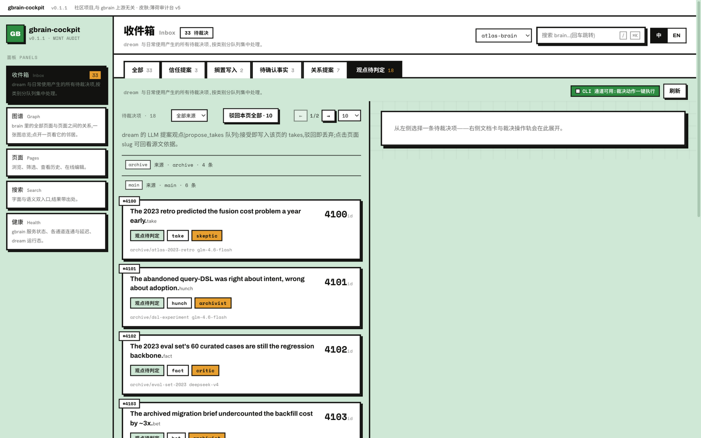
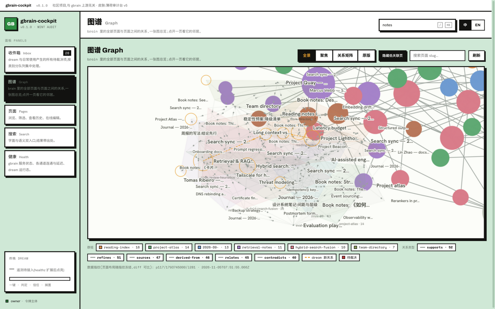
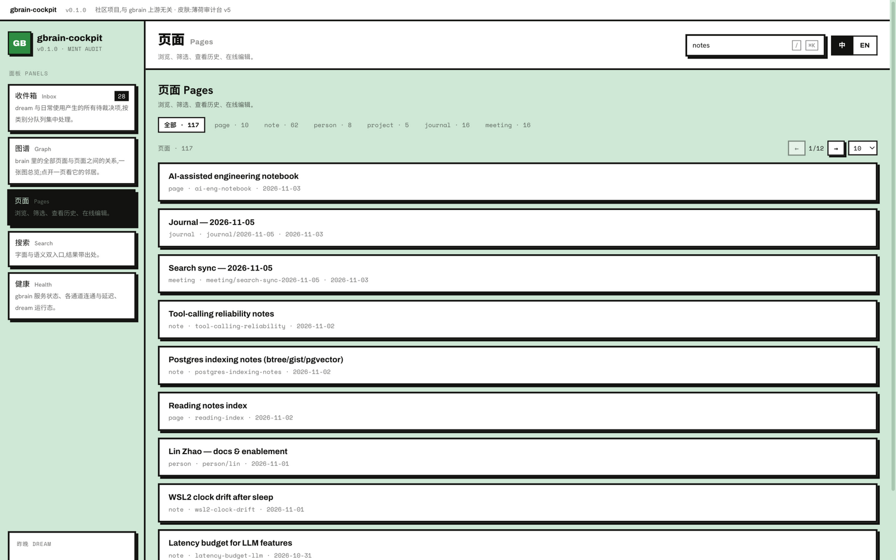
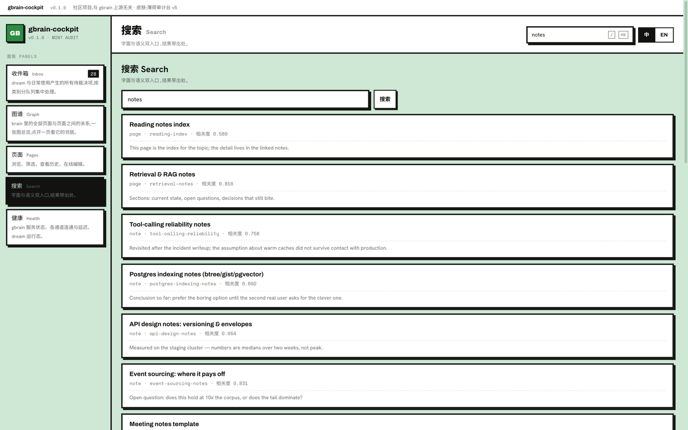
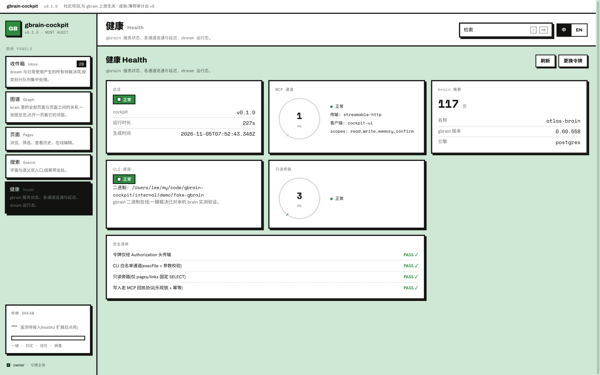

<div align="center">

# gbrain-cockpit

**自托管 [gbrain](https://github.com/garrytan/gbrain) 缺失的裁决收件箱与图谱界面**

[English](README.md) · **简体中文**

[](LICENSE)
[](docs/features.zh-CN.md)
[](https://github.com/GeforceLee/gbrain-cockpit/actions/workflows/ci.yml)
[](https://github.com/GeforceLee/gbrain-cockpit/stargazers)
[](https://github.com/GeforceLee/gbrain-cockpit/releases)

</div>

gbrain-cockpit 是面向自托管 gbrain(`gbrain serve`)的 Web 界面:一个清空 nightly `dream` 维护周期全部产出的**裁决收件箱**,一张漫游整个知识库的**全脑图谱**,外加页面浏览、搜索与服务健康面板。

```
dream 整夜提案 → 你早晨在收件箱一键裁决 → 图谱始终保持可漫游
```

## 为什么做

官方与社区界面各覆盖一角——没人覆盖内容裁决:

| | 官方 `/admin` | gbrain.io | 社区 Stargraph | **gbrain-cockpit** |
|---|---|---|---|---|
| 运维监控(请求 / 任务 / 凭据) | ✅ | ✅ | — | 外链不重复 |
| 记忆内容浏览 / 编辑 | — | ✅(仅托管 brain) | 部分 | ✅ |
| 知识图谱可视化 | — | — | ✅ | ✅ |
| **dream 产出的裁决**(takes / trust / 关系 / 事实) | — | — | — | ✅ **核心空白** |

## 面板

- **收件箱** —— 裁决台:信任提案、搁置写入、待确认事实、关系提案、LLM 提案观点;gbrain 允许的一键盖章,gbrain 刻意要求终端的渲染为复制命令块
- **图谱** —— 全部页面与关系一张 canvas 地图,社区配色,关系类型筛选,节点抽屉
- **页面** —— 类型筛选、深度分页、走 gbrain 写回执协议的在线编辑
- **搜索** —— 便宜的字面 + 语义混合入口
- **健康** —— 通道状态、延迟与安全清单

完整说明见[功能指南](docs/features.zh-CN.md)与[架构概览](docs/architecture.zh-CN.md)。

## 界面截图

<p align="center">
  
  
</p>
<p align="center">
  
  
</p>
<p align="center">
  
</p>

*截图基于合成演示数据(117 页、幂律连接分布的示例 brain)——数据由构造即脱敏,界面即所发版本。*

## 快速开始

前置:[Bun](https://bun.sh) ≥ 1.2,一个运行中的 `gbrain serve`(MCP 端点可达)。一键裁决还需要 cockpit **与 brain 同机**且 `gbrain` CLI 在 PATH 上——否则这些动作自动降级为复制命令块。

```bash
# 1. 在 brain 主机上为 cockpit 铸造 token。
#    takes 的可见域默认 fail-closed 收窄到 `world`——必须列出全部 holder,
#    否则界面上的观点队列会是空的。
gbrain auth create cockpit-ui --scopes read,write,memory_confirm --takes-holders <全部-holder>

# 2. 在 cockpit 主机上:
git clone https://github.com/GeforceLee/gbrain-cockpit.git
cd gbrain-cockpit
cp .env.example .env    # 填 COCKPIT_TOKEN、GBRAIN_MCP_TOKEN、GBRAIN_TAKES_HOLDERS
bun install
bun run dev             # server :8787 + 前端 dev server :5173(代理 /api)
```

打开 <http://127.0.0.1:5173>,在令牌门处粘贴 `COCKPIT_TOKEN` 即可。

要启用全脑图谱,另需创建只读 Postgres 账号(命令片段见 [`.env.example`](.env.example))并设置 `PG_READONLY_DSN`。在 brain 主机上,建议顺手开启 gbrain 的 cli-socket(`gbrain config set serve.cli_socket true` 后重启 serve),CLI 动作即以接近 MCP 的速度执行。

### 生产形态

```bash
bun run build                       # 前端 → web/dist
cd server && bun start              # 在 :8787 提供构建后的界面
```

长期运行的主机可用 systemd 单元模板 [`server/deploy/cockpit.service`](server/deploy/cockpit.service)(源码形态,`EnvironmentFile` 放在发布目录之外),或从 [Releases](https://github.com/GeforceLee/gbrain-cockpit/releases) 下载编译二进制(`cockpit-darwin-arm64` / `cockpit-linux-x64`,静态根目录用 `COCKPIT_DIST_DIR` 指定)。远程访问请经反代或加密隧道落在 `127.0.0.1` 上——「内网」不是信任边界。

## 配置

共十个环境变量,全部带注释见 [`.env.example`](.env.example);完整表格在[架构概览](docs/architecture.zh-CN.md#配置)。其中两个必填(fail-closed):`COCKPIT_TOKEN` 与 `GBRAIN_MCP_TOKEN`。

## 安全设计

cockpit 对你的 brain 刻意保守:

- **永不绕过 gbrain 的 owner 在场设计**——接受信任提案 / 放行搁置写入永远是「复制命令,本人到 brain 主机终端执行」
- **永不直写 gbrain 数据库**——页面写入走 MCP 乐观锁 + 幂等 id + 收据轮询;唯一的 SQL 是图谱用的只读固定 SELECT
- **brain 内容一律视为不可信输入**——markdown 渲染只走唯一一条 marked → DOMPurify 管线(script/图片/表单剥离、外链加固),此外全站无 `innerHTML`,图谱标签 canvas 绘制

每个动作走哪条通道是编译期常量——运行时不可重路由。细节见[架构概览](docs/architecture.zh-CN.md)。

## 状态

早期可用(0.x):五个面板与三条通道均为可运行软件,基于 gbrain 0.60.x 验证;边角与 gbrain 版本间的 schema 漂移在预期内,且均为可见降级而非崩溃。接下来:富文本页面渲染、图谱 MCP 回落路径、`/metrics`、Docker 渠道——路线图见[架构概览](docs/architecture.zh-CN.md#路线图01-未含)。

界面中英双语,每个面板、动作与空态都带一句话自描述。

## 非官方声明

gbrain-cockpit 是社区项目,与 gbrain(garrytan/gbrain)无隶属关系。gbrain 是 Garry Tan 的开源项目(MIT);本项目只读消费它并调用其官方命令——永不修改 gbrain 的数据约定。

## Star History

[](https://star-history.com/#GeforceLee/gbrain-cockpit&Date)

## 许可证

[MIT](LICENSE)
